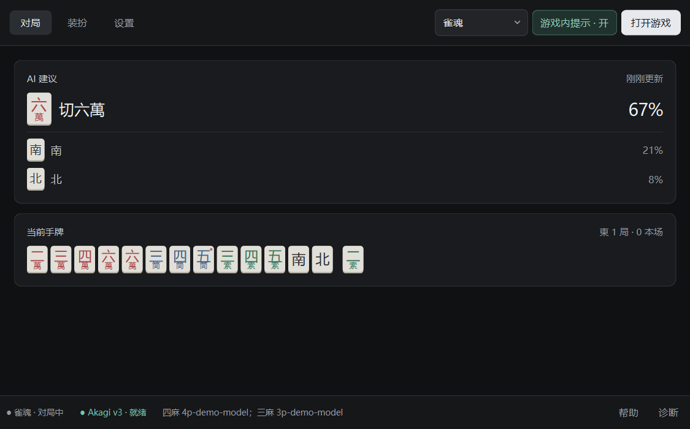
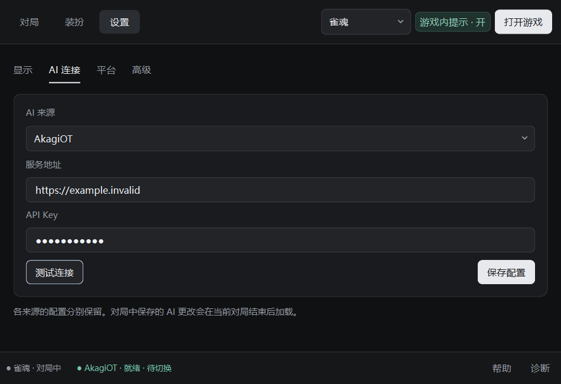
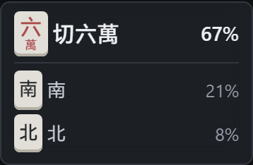
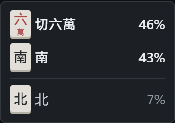
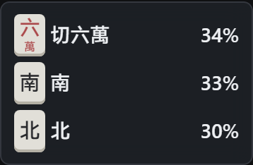
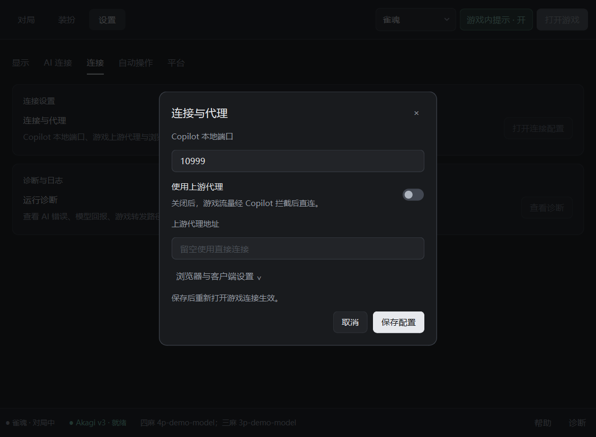
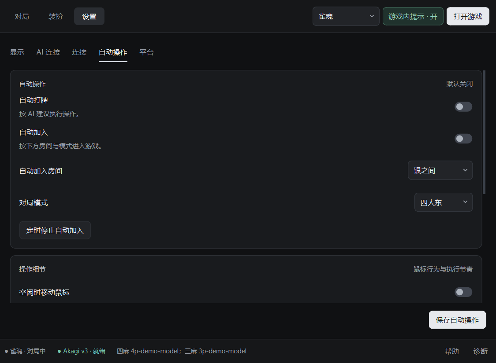
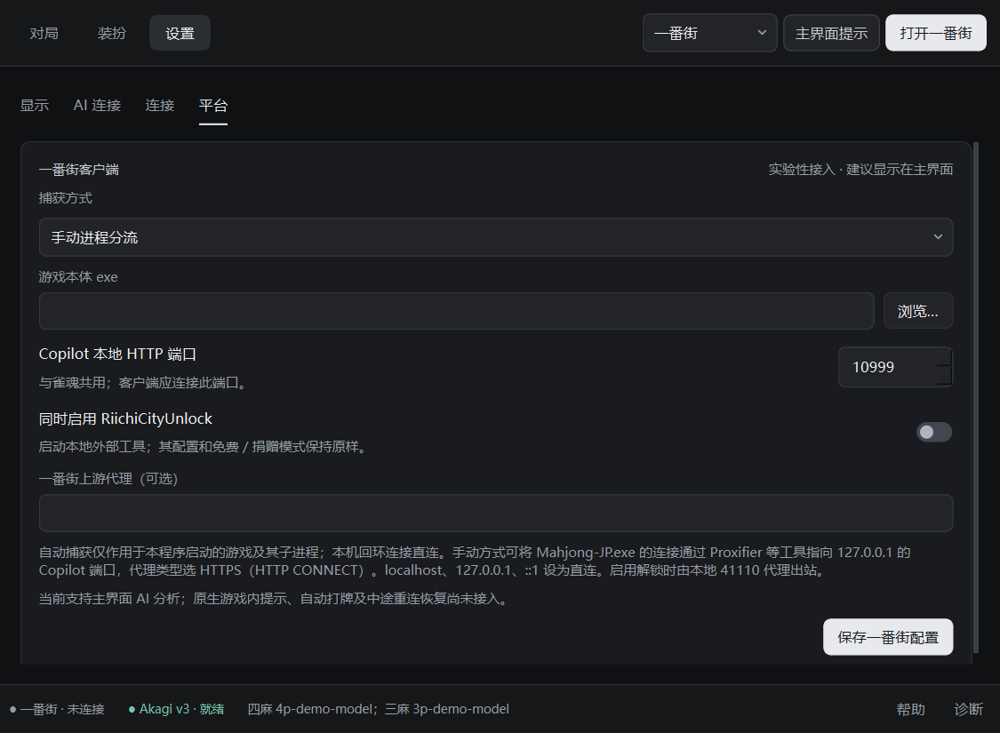
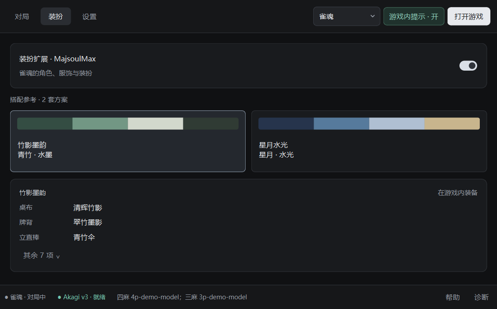

# MahjongCopilotPlus

**简洁的麻将 AI 桌面工具：实时建议、统一提示窗与可选装扮扩展。**


MahjongCopilotPlus 在 [MahjongCopilot](https://github.com/latorc/MahjongCopilot) 的基础上扩展，参考 [MahjongCopilot-max](https://github.com/jiboyingg/MahjongCopilot-max) 的整合思路，接入 [MajsoulMax](https://github.com/Avenshy/MajsoulMax)，并重构桌面界面、设置和提示体验。

当前支持 **雀魂三麻／四麻**，新增 **一番街 Windows 原生客户端实验性接入**（主界面 AI 建议、可选外部 RiichiCityUnlock，真实对局待验证）。Akagi v3 三麻无需本地三麻扩展；本地模型与旧版 OT 的原生库要求见下文。天凤、天月麻将、掌心麻将仍在规划中，尚未实现。本项目与各游戏平台及上游项目没有官方隶属关系。

> **源码部署，通过 `start.bat` 启动。** 请先安装 Python 3.11 x64、依赖与 Chromium；不提供 exe／免安装运行包。更新与问题反馈请使用[本仓库](https://github.com/btlstar/MahjongCopilotPlus)。



截图基于当前源码的实际界面（含未发布的设置分类与提示框分组调整），以离线演示数据生成；`4p-demo-model`／`3p-demo-model` 为虚构示例，不是可用型号、默认型号或最新型号推荐。

## 当前版本

**维护状态：暂缓新增开发。** 2026-11-09 的整理提交保存了此前尚未上传的模型核验、提示框分组、一番街实验性接入与界面改动。当前 `main` 含未单独发布的更新，详见[更新记录中的“未发布”](CHANGELOG.md)。

`v0.1.0-preview.3`：完善 AI 连接与模型状态，修复刷新后的游戏内提示恢复及网络异常时程序误关浏览器的问题。详见[发布页面](https://github.com/btlstar/MahjongCopilotPlus/releases/tag/v0.1.0-preview.3)与[更新记录](CHANGELOG.md)。

## 特性

- **一番街实验性接入**：协议转换接入现有 AI 与模型核验；支持仅代理本次启动客户端的进程捕获，也可手动分流；可串联自行准备的 RiichiCityUnlock，工具二进制不随仓库分发。参阅[一番街配置](docs/RIICHICITY.md)。

- **深色桌面界面**：Qt 紧凑顶栏，“对局／装扮／设置”三个主页面，设置、帮助、诊断和连接配置均在程序内显示。
- **统一麻将牌样式**：万、筒、索分别用红、蓝、绿区分，赤五有额外标记；主界面与游戏内提示一致。
- **简洁提示**：雀魂只保留游戏内卡片，可拖动并记住位置；接近推荐值的两至三项同色提亮，分割线随组移动，字号与行高固定；顶栏与设置页开关即时同步。
- **两键老板键**：默认推荐 `Alt+Q`，另有 `Alt+Z`、`Alt+X` 和自定义选项，隐藏／恢复程序及它启动的游戏浏览器或一番街客户端窗口。
- **多种 AI 来源**：AkagiOT、MJAI、兼容的本地 Mortal 模型；根据来源显示对应设置，本地模型可浏览选择文件。Akagi v3 支持获取授权列表后手动选择四麻／三麻型号；底栏显示已加载型号和真实响应核验结果；v3 逐次校验模型 ID，异常不降级，推理核验历史可在诊断中查看。
- **可选装扮扩展**：MajsoulMax 集成、资源和协议更新，以及搭配参考；当前不提供从 GUI 批量应用或对局中即时换装。
- **窗口适配**：游戏窗口可调整大小；手动操作模式不再因 Windows 显示缩放反复弹出 100% 缩放错误。
- **自动操作保留**：雀魂自动打牌、自动加入和定时停止集中于独立设置页；操作细节直接显示，保存入口固定在页底，默认关闭自动操作。

<details>
<summary>更多界面截图</summary>

AI 连接设置：密钥显隐、按玩法选择型号、获取列表与测试连接。



游戏内提示卡片（局部截图）：与主界面共享麻将牌样式，整张卡片可拖动，不另开独立窗口。



两项接近时，百分比同色，分割线移到第二项后：



三项接近时，同等提亮，不显示分割线：



程序内连接配置：本地端口与上游代理分开设置，图中为关闭上游代理。



自动操作：与连接、诊断分开，细节无需展开，底部固定保存入口。



一番街平台设置：按需选择进程捕获和外部解锁工具，截图为未配置的演示表单。



雀魂装扮搭配参考：在游戏内逐项装备，不支持 GUI 一键应用。



截图不包含个人账号、真实密钥或私人对局，也不表示已连接线上服务。

</details>

## 快速开始

### 运行环境

- Windows x64，建议使用 **Python 3.11 x64**。当前桌面和老板键验证以 Windows 为主。
- 可访问 Python 包源及 Playwright Chromium 下载源。
- 至少一种可用 AI 来源；本仓库不附带 API Key、账户或模型权重。

### 获取源码

推荐通过 GitHub Desktop Clone 本仓库，后续在同一目录 Pull 更新。也可下载 Release 的 `Source code (zip)` 后安装依赖；该文件仅包含源码。

更新及旧版配置迁移见[升级说明](docs/UPGRADING.md)。

### 源码安装与启动

在 PowerShell 中执行：

```powershell
git clone https://github.com/btlstar/MahjongCopilotPlus.git
cd MahjongCopilotPlus
py -3.11 -m venv venv
.\venv\Scripts\python.exe -m pip install --upgrade pip
.\venv\Scripts\python.exe -m pip install -r requirements.txt
.\venv\Scripts\python.exe -m playwright install chromium
.\venv\Scripts\python.exe desktop_entry.py
```

完成安装后，可双击根目录 **`start.bat`**。它使用项目内的 `venv`，不是免安装启动器。

首次启动会生成本地 `settings.json`。以 Akagi v3 为例：

1. 打开“设置 → AI 连接”，选择 `AkagiOT` 和 `Akagi v3 · 可选模型`，填写对应 API Key。
2. 点击“获取可用模型”，在四麻／三麻下拉框选择所需型号；至少选择一种玩法，留空的玩法不启用。
3. 测试连接后保存，等待底部状态栏显示就绪及已加载型号。测试通过只代表连接与授权检查通过。
4. 点击“打开游戏”，在程序启动的浏览器中进入对局。顶栏“游戏内提示”控制游戏内卡片；收到实际响应后，底栏会显示“已核验”；没有建议时可从右下角“诊断”查看推理失败原因和逐次模型记录。

如果显示代理证书安装错误，按[安装与排错说明](docs/INSTALL.md)处理。不要将程序生成的证书私钥、浏览器资料或含凭据的设置文件提交到 GitHub。

### 一番街客户端

顶栏选择“一番街”，在“设置 → 平台”保存游戏本体路径与捕获方式，可选启用外部 RiichiCityUnlock。请先关闭原先打开的游戏，再从 Copilot 启动；目前建议仅在主界面显示，不支持原生游戏内提示、自动操作或中途重连恢复。详细操作与验证边界见[一番街配置](docs/RIICHICITY.md)。

### AI 与原生库

| 来源 | 需要准备 |
| --- | --- |
| Akagi v3（AkagiOT 来源） | 对应服务的 API Key；获取授权列表后手动选择四麻／三麻型号；三麻无需本地扩展 |
| 旧版 OT（AkagiOT 来源） | 兼容旧接口的地址与密钥；使用服务端默认型号，三麻需要额外原生库 |
| MJAI | 服务地址、已有账户的用户名和密钥，以及可用模型 |
| 本地 Mortal | 与当前引擎兼容的权重；四麻与三麻分别选择文件 |

本地模型和旧版 OT 的四麻原生依赖通过 `requirements.txt` 中的 `riichi` 安装；其三麻还需单独取得匹配 Python 版本、系统和架构的 `libriichi3p`，它不随本源码仓库分发。**Akagi v3 使用服务端推理，三麻无需该本地扩展。**具体文件名和注意事项见[安装说明](docs/INSTALL.md#三麻原生库)。模型权重和外部原生库始终遵循其原始分发条款。

不同来源与新旧 Akagi 接口分别保存配置，密钥不保证通用。切换来源只切换表单；保存后的新模型在非对局状态加载，对局中更改延后至当前对局结束。详见[AI 配置说明](docs/INSTALL.md#ai-配置)。

## 装扮扩展

内置集成基于 MajsoulMax `v2026.07.07`，资源／协议快照为 MajsoulData `0.16.289-4.0.51`。准确版本、来源和校验值见 [data_version.json](mjmax/config/data_version.json)，更新方式见[集成说明](mjmax/INTEGRATION.md)。这不是“永久支持所有最新皮肤”的保证。

装扮在游戏内选择，个人选择写入被 Git 忽略的本地配置。GUI 中的搭配为参考，不会自动替换你的装备。修改效果属于本地客户端显示，不会给账号增加服务器端拥有的物品。

## 功能范围与使用提示

| 平台 | 当前状态 |
| --- | --- |
| 雀魂 | 已接入；模型、原生库和游戏协议版本需匹配 |
| 一番街 | 实验性原生客户端协议与 AI 接入；外部解锁可选；真实对局待验证 |
| 天凤 | 规划中 |
| 天月麻将、掌心麻将 | 规划中 |

这是学习、研究与个人实验项目。请遵守游戏平台规则，避免破坏公平对局；AI 实时辅助、自动操作或客户端修改可能导致账号处罚。项目不保证规避检测，不提供账号安全或胜率保证。

程序按许可证规定以“现状”提供。游戏素材、商标、模型权重及第三方服务不因本项目开源而获得额外授权。

## 文档与开发

- [安装与排错](docs/INSTALL.md)
- [升级与配置迁移](docs/UPGRADING.md)
- [资源下载与 TUN／直连排查](docs/NETWORK.md)
- [一番街实验性接入](docs/RIICHICITY.md)
- [桌面使用说明](DESKTOP.md)
- [MajsoulMax 集成与数据更新](mjmax/INTEGRATION.md)
- [贡献指南](CONTRIBUTING.md)
- [更新记录](CHANGELOG.md)
- [第三方来源与许可](THIRD_PARTY_NOTICES.md)
